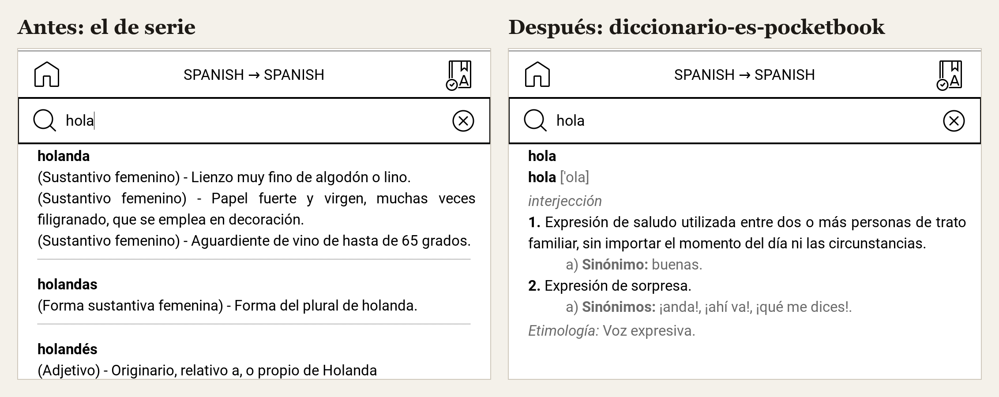
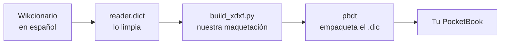

# Diccionario de español para PocketBook

Un diccionario de español **gratis, completo y bien maquetado** para lectores PocketBook. Mantén pulsada una palabra mientras lees y tendrás su definición, como en un Kindle.



**[⬇ Descargar la última versión](../../releases/latest)** · un solo archivo `.dic` de unos 18 MB

| | |
|---|---|
| Palabras con definición | 110.616 |
| Formas que se pueden buscar | 924.611 (plurales y conjugaciones incluidos: *fuimos* → **ser**) |
| Fuente | Wikcionario en español, actualizado cada mes |
| Funciona en | PocketBook con firmware 6.x (Verse, Verse Pro, Era, InkPad, Touch…) |

## Por qué

El diccionario de español que traen los PocketBook es una conversión antigua del Wikcionario: definiciones amontonadas, sin acepciones separadas y sin conjugaciones. Los buenos (el de la RAE, el que lleva el Kindle) no son de uso libre y no se pueden instalar.

Así que hemos hecho uno nuevo a partir del Wikcionario, que sí es libre, cuidando cómo se ve en la pantalla del lector.

## Cómo se ve

```
pequeño
[peˈkeɲo]
adjetivo
1. De tamaño reducido, menor a lo común o normal.
     a) Sinónimos: chico, corto, escaso, reducido.
2. Que es escaso en número.
3. De poca edad.
…
Etimología: Voz expresiva.
```

- La pronunciación en gris, debajo de la palabra (que el lector ya pone como título).
- La categoría en cursiva (*sustantivo*, *verbo*…).
- Las acepciones numeradas, con la materia en cursiva (*Mamíferos.*, *Física.*).
- Sinónimos debajo de su acepción y etimología al final, en gris.
- Las formas sin entrada propia llevan a su palabra: *perros* → **perro**, *fuimos* → **ir** y **ser**.

## Instalación

1. Descarga `diccionario-es.dic` de la [última versión](../../releases/latest).
2. Conecta el PocketBook al ordenador por USB y elige **Conexión a PC**.
3. Copia el archivo a la carpeta **`system/dictionaries`** del lector. La carpeta `system` está oculta: en Mac pulsa `Cmd + Mayús + .` en el Finder; en Windows activa «Mostrar elementos ocultos». Si `dictionaries` no existe, créala.
4. Expulsa el lector y ve a **Ajustes → Idioma y diccionarios → Diccionarios**. Elige **Diccionario de español**.

Aparece en la categoría Español → Español. Para quitarlo, borra el archivo.

**¿Kindle o Kobo?** Este archivo es solo para PocketBook. Para Kindle y Kobo, [reader.dict](https://www.reader-dict.com/download/es) publica gratis el mismo Wikcionario en sus formatos.

## Cómo se ha hecho



1. **Las definiciones** vienen del [Wikcionario en español](https://es.wiktionary.org). El proyecto [reader.dict](https://www.reader-dict.com) lo procesa y publica cada mes en un formato de texto limpio (DictFile).
2. **`build_xdxf.py`** reescribe cada entrada con nuestra maquetación en HTML: los PocketBook pintan las definiciones con el motor de texto enriquecido de Qt, así que admiten negrita, cursiva, colores y márgenes. También crea una entrada corta para cada forma flexionada (814.000), porque el formato `.dic` no admite varias claves por entrada.
3. **[pbdt](https://codeberg.org/datyoma/pbdt)**, una herramienta de código abierto, empaqueta el `.dic`. Al principio usamos el conversor oficial de PocketBook (un programa de Windows que hay que ejecutar con Wine), pero no escribe los metadatos de idioma y el lector clasificaba el diccionario en «Otros». pbdt sí los escribe (`localeFrom: es`, `localeTo: es`) y además no necesita Windows.
4. Las reglas de ordenación y de formas del español (`collates.txt`, `morphems.txt`, `keyboard.txt`) vienen de [LanguageFilesPocketbookConverter](https://github.com/Markismus/LanguageFilesPocketbookConverter) y se descargan al construir.

Una tarea automática de GitHub lo reconstruye el día 5 de cada mes y publica una versión nueva.

### Construirlo tú

Necesitas Python 3 y Docker (o Go 1.25):

```bash
./build.sh
```

El resultado queda en `dist/diccionario-es.dic`.

## Licencia y créditos

- **Definiciones:** autores del [Wikcionario](https://es.wiktionary.org), bajo [CC BY-SA 4.0](https://creativecommons.org/licenses/by-sa/4.0/deed.es). El archivo `.dic` se distribuye con esa misma licencia: puedes compartirlo y modificarlo citando la fuente y manteniendo la licencia.
- **Limpieza del Wikcionario:** [reader.dict](https://www.reader-dict.com) (Mickaël Schoentgen y colaboradores).
- **Empaquetado:** [pbdt](https://codeberg.org/datyoma/pbdt), de Artem Tarasov (MIT).
- **Código de este repositorio** (`build_xdxf.py`, `build.sh`): MIT.

PocketBook es una marca de PocketBook International SA. Este proyecto no está afiliado a PocketBook.
